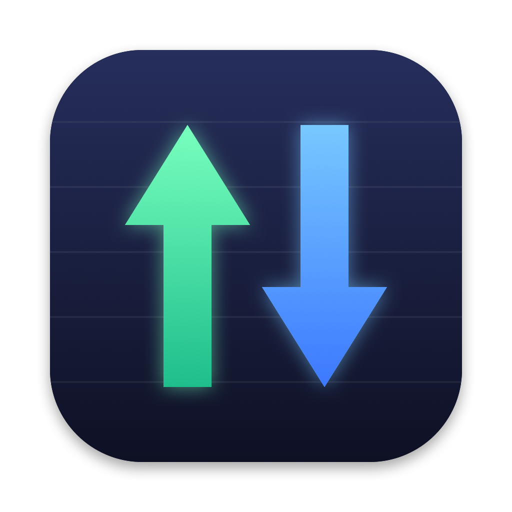

<p align="center">
  
</p>

<h1 align="center">NetSpeed</h1>

<p align="center">
  La vitesse de ta connexion, en direct, dans la barre des menus du Mac.<br>
  <em>Live upload / download speed in the macOS menu bar.</em>
</p>

---

NetSpeed affiche en permanence, sur deux lignes, la vitesse d'**envoi (↑)** et de **réception (↓)** de ton Mac, mise à jour chaque seconde, dans l'esprit d'iStat Menus, en ultra simple.

```
↑ 45 Ko/s
↓ 1.2 Mo/s
```

## Fonctionnalités

- Vitesses ↑ / ↓ rafraîchies chaque seconde, en Ko/s, Mo/s ou Go/s
- S'adapte automatiquement au mode clair / sombre
- Aucune icône dans le Dock, juste la barre des menus
- Deux modes de mesure, au choix dans le menu :
  - **Interface principale** : la connexion utilisée pour Internet (Wi-Fi ou Ethernet)
  - **Toutes les interfaces** : additionne Wi-Fi, Ethernet USB-C, etc. (sans les VPN, pour ne pas compter deux fois)
- Volume total échangé depuis le lancement
- Option **Lancer à l'ouverture de session**
- Très léger : un seul fichier Swift, aucune dépendance

**Compatibilité :** macOS 13 Ventura ou plus récent, Mac Apple Silicon et Intel.

## Installation

1. Télécharge **NetSpeed.dmg** depuis la page [Releases](../../releases).
2. Ouvre-le et glisse **NetSpeed** dans **Applications**.
3. Au premier lancement, macOS bloque l'app (« impossible de vérifier le développeur »), car elle n'est pas signée avec un compte développeur Apple.
   Va dans **Réglages Système → Confidentialité et sécurité**, descends en bas et clique sur **Ouvrir quand même**.
   C'est à faire une seule fois.

## Compiler soi-même

Il faut les outils en ligne de commande d'Apple (`xcode-select --install`), pas besoin de Xcode.

```bash
git clone https://github.com/<ton-compte>/NetSpeed.git
cd NetSpeed
./build.sh --install    # compile et installe dans ~/Applications
```

| Commande | Résultat |
|---|---|
| `./build.sh` | crée `NetSpeed.app` dans le dossier |
| `./build.sh --install` | idem + installe dans `~/Applications` |
| `./package.sh` | crée l'installeur `NetSpeed.dmg` |
| `swift icon.swift icon.png` | redessine l'icône |

## Comment ça marche

NetSpeed lit chaque seconde les compteurs d'octets envoyés et reçus de macOS (compteurs 64 bits via `sysctl`), et affiche la différence. L'interface principale est celle que macOS utilise pour Internet. Aucune donnée ne quitte ton Mac : l'app ne se connecte à rien.

## Fichiers

| Fichier | Rôle |
|---|---|
| `main.swift` | le code de l'app |
| `icon.swift` | dessine l'icône |
| `icon.png` | l'icône (1024 × 1024) |
| `build.sh` | compile l'app |
| `package.sh` | crée le .dmg |

## Licence

[MIT](LICENSE) : libre d'utiliser, modifier et partager.
